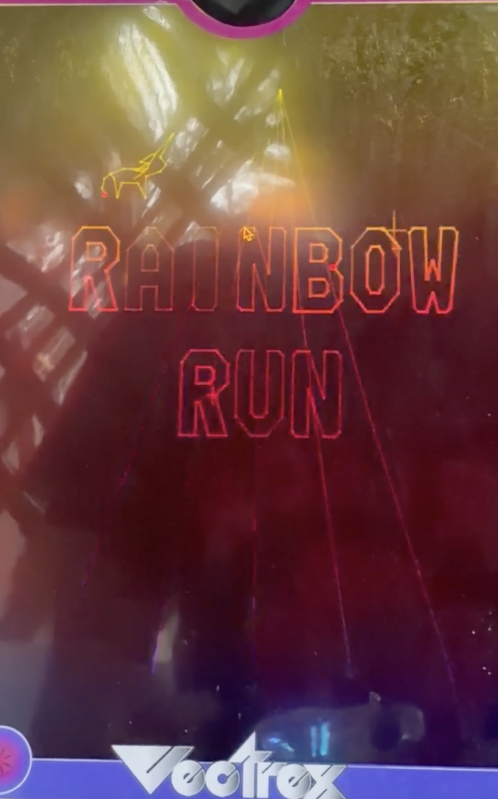
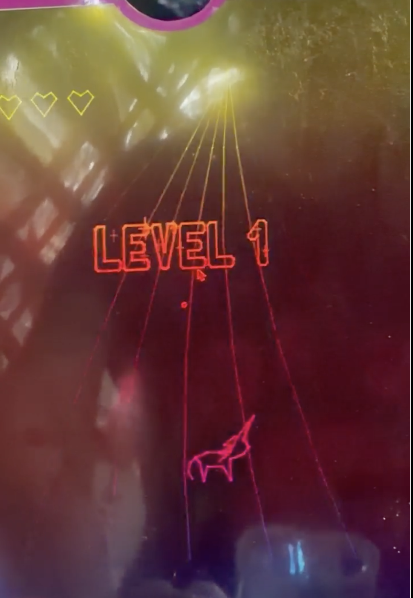
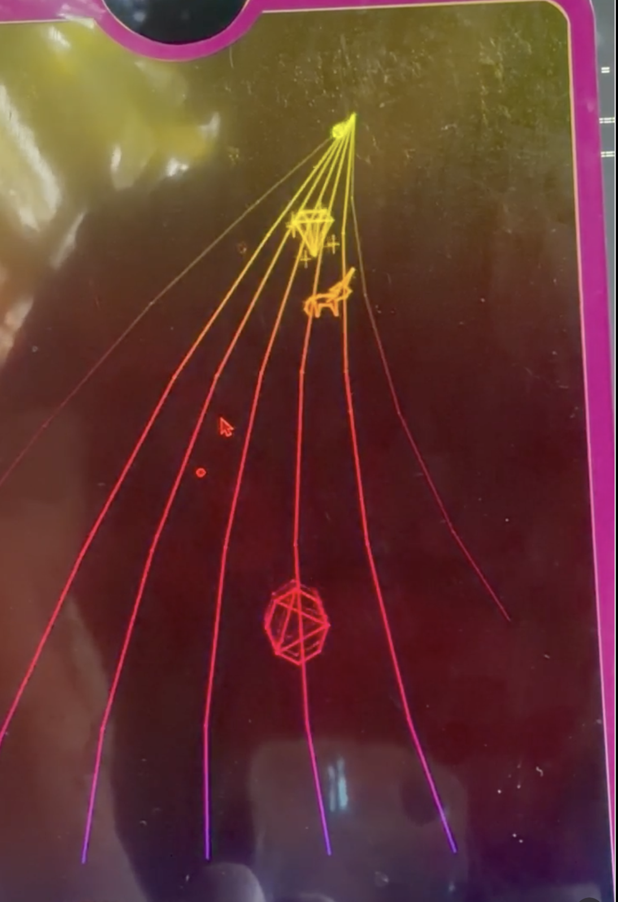

# Rainbow Run

A Vectrex game: a unicorn racing up a curving rainbow road, viewed
the way Web Wars views its web. Built with VectreC (CMOC), tested in VIDE.

<p align="center">
  
  
  
</p>

> Personal hobby project, inspired by *Web Wars* and *Robot Unicorn Attack*. Not affiliated with the makers of either game.

## Play it

Download `rainbow.bin` from the [latest release](../../releases) and run it in a Vectrex emulator such as VIDE (**Vecci → Run** → pick `rainbow.bin`), or load it onto a flash cartridge to play on a real Vectrex.

## Files

| File | Purpose |
|---|---|
| `main.c` | Game loop, road curve, hazards, levels, title screen |
| `shapes.h` | All vector art: unicorn, hazards, trophies (generated) |
| `road.h` | Rainbow road geometry and curve tables, precomputed so nothing is multiplied at run time (generated) |
| `title.h` | Bubble-letter outlines and glint points for the title (generated) |
| `font.h` | Bubble-letter font for on-screen messages, simplified for small sizes (generated) |
| `music.h` | The theme: melody, bass, sparkle arpeggio and drums |
| `.vscode/tasks.json` | Lets Cmd-Shift-B build the game in VS Code |

## Build and run

**Requirements:** [CMOC](http://sarrazip.com/dev/cmoc.html) with Vectrex support, and the VectreC standard library. Point the `VECTREC` environment variable at your VectreC folder:

```bash
export VECTREC=/path/to/vectrec
```

In VS Code, press **Cmd-Shift-B**, or run in the terminal:

```bash
cmoc --vectrex -I $VECTREC/stdlib -L $VECTREC/stdlib -o rainbow.bin main.c
```

Then in VIDE: **Vecci → Run** → pick `rainbow.bin`.

## Controls

| Input | Action |
|---|---|
| Joystick left/right | Switch lanes: 6 (a corner on each side, four across the floor) |
| Joystick up/down | Run forward up the rainbow / drift back |
| Button 1 | Jump (title screen: start) |
| Button 2 | Blink: instantly reappear at a random lane and depth |

## Levels

Five levels. Each starts with "LEVEL n" for a second and a half (you can already
move), then hazards start coming right away. About 17 seconds in, a
trophy comes down the rainbow; be in its lane when it reaches you to clear the level (and get
a heart back). LEVEL COMPLETE and a cheer for that level sparkle in, in
bubble letters like the title, for about four seconds. Miss the trophy and another comes about 7 seconds later. The
cheers are in `phrase()` in `main.c` (update `phrase_len()` to match).

| Level | Trophy |
|---|---|
| 1 | Diamond |
| 2 | Heart |
| 3 | Horseshoe |
| 4 | Crescent moon |
| 5 | Rainbow: YOU WIN!! YOU RULE THE WORLD! |

Each level is faster, with hazards spawning more often and more eagles.
The difficulty table (`lvl_speed`, `lvl_gap`, `lvl_mask`, `lvl_eagle`)
is near the top of `main.c`.

## Hazards

| Hazard | Behavior | Counter |
|---|---|---|
| Tumbleweed | Rolls sideways across lanes | Jump or dodge |
| Hobble | Rope across two lanes | Jump |
| Eagle | Flies overhead shadowing your lane, then fires a fireball | Dodge the fireball; jumping doesn't help |

## Credits

Music is an original composition.